# AWS VPC Lab

A secure, monitored, multi-AZ web tier on AWS, built by hand in the console and
re-created with the AWS CLI.

## Architecture
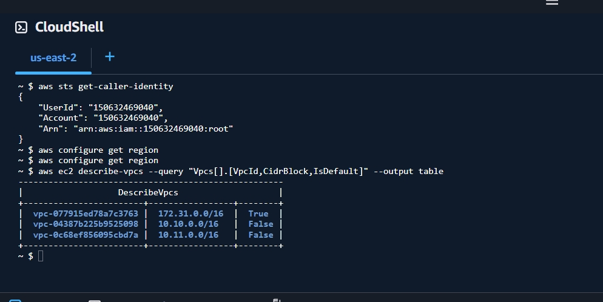

- VPC 10.20.0.0/16 with public and private subnets in two Availability Zones
- Bastion host in a public subnet; app servers in private subnets with no public IP
- Application Load Balancer across two AZs with health checks
- S3 reached privately through a gateway endpoint and an IAM role (no internet route)

## What I built
- **Network design:** CIDR plan, public vs private route tables, internet gateway,
  temporary NAT gateway (removed the same day to control cost)
- **Layered security:** security groups referencing each other, a stateless network
  ACL, SSH only through the bastion (ProxyJump), IMDSv2 required, hardened AMI
- **Monitoring:** VPC Flow Logs queried with Logs Insights, CloudWatch alarm with an
  SNS email notification for unhealthy targets
- **Resilience test:** stopped a web server and verified the load balancer kept serving
- **Automation:** `build_vpc.sh`, `destroy_vpc.sh` (tag-protected) and `cost_guard.sh`

## Security group rules
| Group | Inbound | Source |
|---|---|---|
| lab-bastion-sg | SSH 22 | my IP |
| lab-app-sg | SSH 22 / HTTP 80 | lab-bastion-sg / lab-alb-sg |
| lab-alb-sg | HTTP 80 | my IP |

## Findings from Flow Logs
- Over 80 REJECT records appeared within an hour, all with the bastion's network
  interface as the destination and public internet addresses as the source:
  background internet scanning
- Probed ports included 23 (Telnet), 1433 (MSSQL), 27017 (MongoDB) and 8080
- One address repeated on port 23 (7 attempts), typical scanner behaviour
- These were stopped by the bastion's security group (SSH from my IP only).
  A REJECT record does not say whether the security group or the NACL blocked
  the traffic, so both have to be checked

## Challenges and what I learned
- I edited the default network ACL instead of my custom one, which blocked SSH to
  the bastion. I fixed it from the console and learned to check the ACL ID before saving
- dnf was OOM-killed on a 1 GB t3.micro; a temporary swapfile fixed it
- NACLs are stateless: removing one reply rule broke SSH although the security
  group allowed it. An explicit deny with a lower rule number also overrode an allow
- A NAT gateway's Elastic IP is not released with the gateway and keeps billing
- The console wording changed (Regional vs Zonal NAT, new Log Analytics page), so I
  followed the intent of each step rather than the exact menu names

## Cost control
The NAT gateway ran for about 60 minutes and the load balancer for about
2 hours. Everything was deleted on 2026-10-31 and cost_guard.sh shows no
project resources left.

## Tools
AWS VPC, EC2, ALB, S3, IAM, CloudWatch, SNS, AWS CLI, CloudShell, Bash, Git

## Evidence
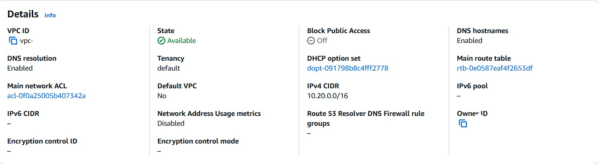
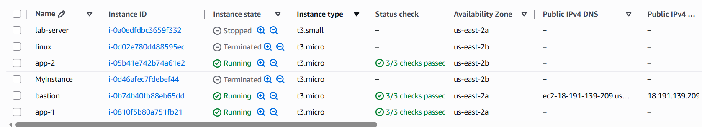
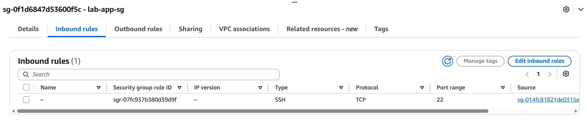
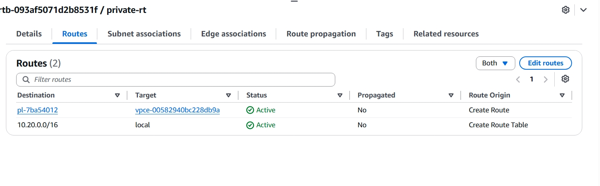
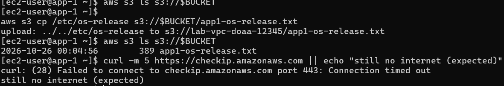
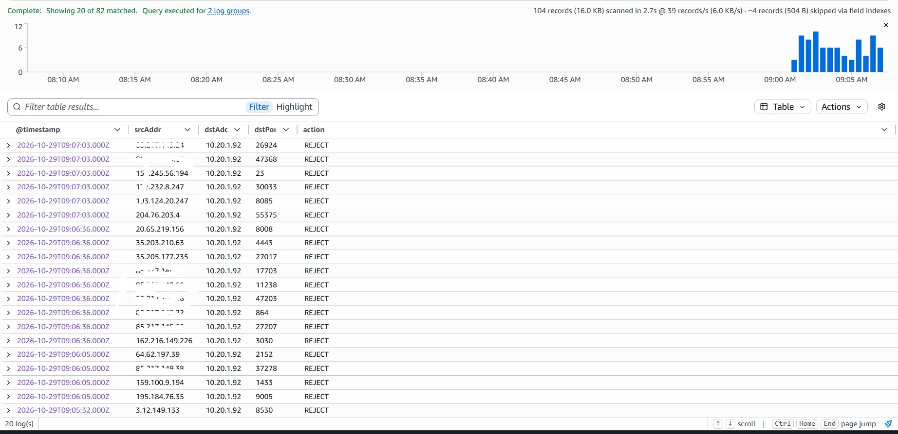
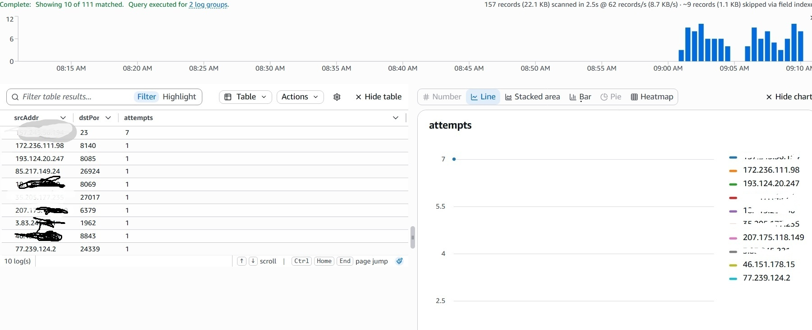
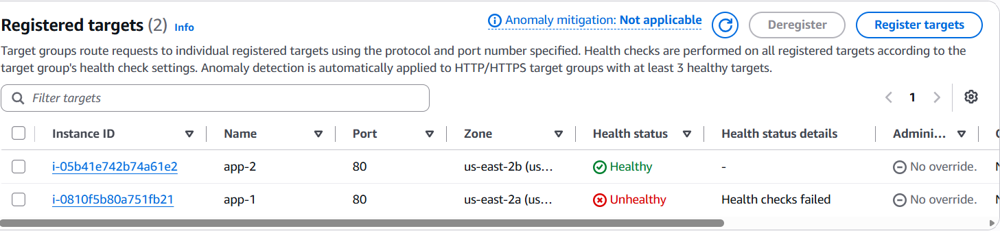
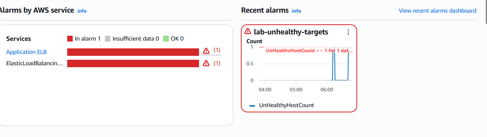
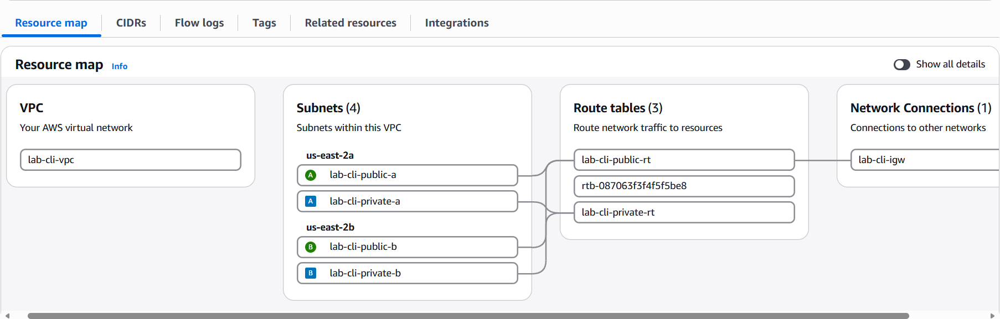
